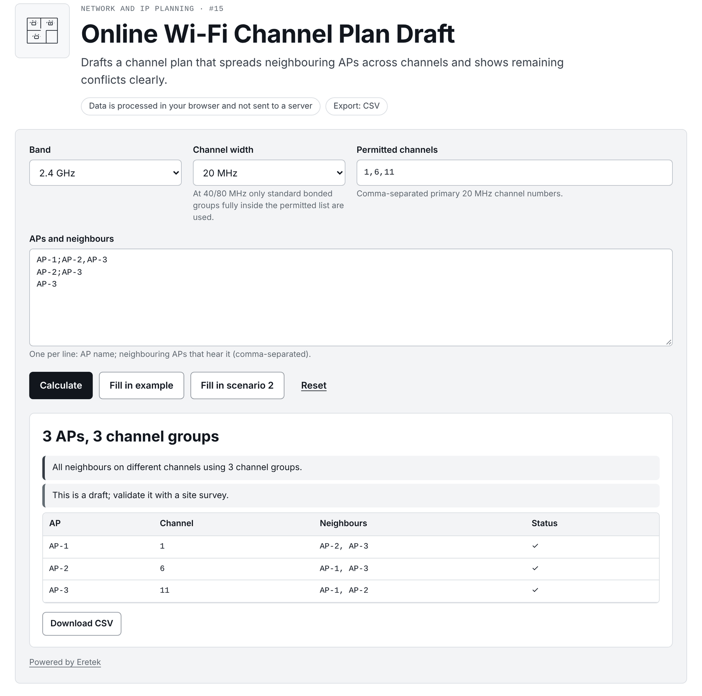

# Wi-Fi Channel Plan Draft

Create a 2.4/5 GHz channel plan draft from neighbouring access points and permitted channels; 20/40/80 MHz bonding, unresolved co-channel conflicts flagged.

## Try it live

- [Türkçe](https://network.eretek.com/araclar/wifi-kanal-plani)
- [English](https://network.eretek.com/en/tools/wifi-channel-plan)
- [Deutsch](https://network.eretek.com/de/werkzeuge/wlan-kanalplan)



## What it does

Drafts a channel plan that spreads neighbouring APs across channels and shows remaining conflicts clearly.

Neighbouring APs on the same channel share airtime and wait for each other (co-channel contention). A channel plan gives APs that hear each other different channels. The tool drafts an assignment from the neighbour relationships you enter and the channels **you have verified as permitted in your country**. It is not a site survey.

## Where it helps

When entering the draft into the WLAN controller, validate it with site survey measurements. Taking neighbours from the controller's RF neighbour report is more accurate than estimating.

Common fixes for remaining conflicts: lower AP power, narrow the channel width or disable the 2.4 GHz radio on some APs.

## How to use it

1. Choose band and channel width. Only 20 MHz is supported on 2.4 GHz.
2. List usable channels (e.g. `1,6,11` for 2.4 GHz; `36,40,44,48,52,...` for 5 GHz). Verify the country regulations and DFS use yourself.
3. Write `AP; neighbour1,neighbour2` on each line. Neighbourhood is two-way; write it once.

### Fields

| Field | Description |
|---|---|
| Band |  |
| Channel width | At 40/80 MHz only standard bonded groups fully inside the permitted list are used. |
| Permitted channels | Comma-separated primary 20 MHz channel numbers. |
| APs and neighbours | One per line: AP name; neighbouring APs that hear it (comma-separated). |

## Example input

Press **Fill in example** in the tool to load this input.

| Input | Value |
|---|---|
| Band | `2.4 GHz` |
| Channel width | `20 MHz` |
| Permitted channels | `1,6,11` |

**APs and neighbours**

```text
AP-1;AP-2,AP-3
AP-2;AP-3
AP-3
```

**Expected result:** AP-1 → 1, AP-2 → 6, AP-3 → 11; no conflict.

## Method and assumptions

APs and neighbours form a graph; channel assignment is graph colouring. The DSatur heuristic is used: the AP with the most differently-coloured neighbours goes first, ties go to the AP with most neighbours, and the least-used suitable channel is chosen.

At 40 and 80 MHz the standard 5 GHz bonding groups (36-40, 44-48, …; 36-48, 52-64, …) are used; every channel of a group must be in the permitted list. On 2.4 GHz entered channels must be at least 5 channels apart (non-overlapping).

When colours run out, the heuristic tries to minimise conflicts; it does not prove a conflict is theoretically unavoidable.

## Limits and common mistakes

- Country regulations are not applied; you enter the permitted channels. DFS channels being vacated on radar detection is not considered.
- Signal strength, wall attenuation and coverage are not calculated; only channels are assigned.
- The 6 GHz band is not included in this version.

## Run it locally

The tool is plain HTML, CSS and JavaScript with no build step and no dependencies.

```bash
git clone https://github.com/eretek/wifi-channel-plan.git
cd wifi-channel-plan
node scripts/serve.js        # or: python3 -m http.server 8080
```

Open <http://127.0.0.1:8080/>. Add `?lang=tr` or `?lang=de` for Turkish or German; without it the page follows the browser language and falls back to English. You can also open `index.html` directly from disk.

Run the tests (Node.js 18 or later):

```bash
node test/run.js    # or: npm test
```

The tests run the tool's own fixtures and the worked examples in all three languages without a browser.

## How it works

All processing happens in your browser. The tool makes no network requests, uses no cookies or browser storage, and does not upload files you select.

No server-side component is needed. The version on the Eretek website renders the same page through a private WordPress plugin; that plugin only produces the page markup and is not part of this repository.

| Path | Purpose |
|---|---|
| `index.html` | Page shell |
| `src/app.js` | Builds the page in Turkish, English or German from `src/data.js` |
| `src/data.js` | Field definitions, examples and all texts in three languages |
| `src/core.js` | Shared runtime: validation, number formats, result rendering, CSV/ICS export |
| `src/tool.js` | The calculation or analysis for this tool |
| `docs/screenshot.png` | Screenshot used in this README |
| `src/tools.css`, `src/page.css` | Styles |
| `test/run.js`, `test/cases.json` | Headless tests |

## License and attribution

This tool is released under the [Eretek Website Attribution License](LICENSE). You may use, modify and redistribute it, including commercially. If you make it available on a website or web application, show a visible, clickable credit linking to https://eretek.com/ on every page where the tool is available, for example:

```html
<a href="https://eretek.com/">Powered by Eretek</a>
```

You may add `rel="nofollow"` to the link. Keep the copyright notice and license text in copies and redistributions.
